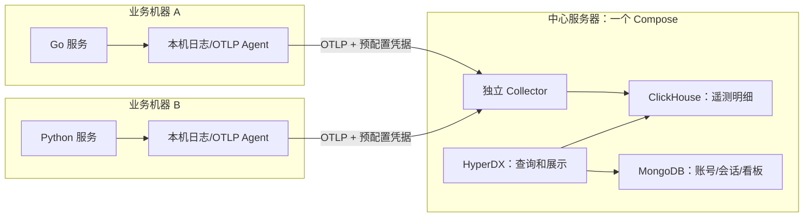

# Observability Infra

本项目维护公共 Demo 的中心可观测基础设施：**独立 Collector + ClickHouse + HyperDX + MongoDB**。四个中心组件仍部署在同一台服务器、由同一份 Docker Compose 管理；多台 Go/Python 业务机器通过 OTLP 汇聚日志和 Span。

Collector 保留 `hyperdx/hyperdx-otel-collector:2.43.1`，使用它真正的 **standalone 独立模式**，沿用已有导出器和 legacy/Map 表结构。不需要先启动 HyperDX、注册账号或获取 UI 团队密钥才能初始化采集。所有镜像固定版本，不编译上游源码。

从配置逐项学习整条链路，可先阅读带架构图、启动图和时序图的 [Compose 配置与链路详解](compose-yaml.md)。

## 组件与数据流



业务 SDK 也可以直接向中心发送 OTLP。读取文件的 Agent 应部署在日志所在的业务机器上；中心服务器的目录挂载无法读取另一台机器的本地文件。普通 Compose 管理中心这一台机器上的容器，不负责跨机器调度业务 Agent。

Collector 仅等待 ClickHouse 健康。HyperDX 查询 ClickHouse，并将自身平台状态保存在 MongoDB；它不再向 Collector 下发 OpAMP 配置，也不控制采集密钥。

## 文件职责

| 文件 | 职责与生效方式 |
| --- | --- |
| `compose.yaml` | 中心四组件的镜像、依赖、端口、环境变量、挂载和详细注释 |
| `compose-yaml.md` | 从 Compose 入口解释多机汇聚、配置加载、认证、存储和网页访问链路，配套 Mermaid 图 |
| `.env.example` | 公共配置模板，不包含实际密钥；复制为 `.env` 后设置真实参数 |
| `.env` | 当前部署的私有参数；不提交到公共仓库 |
| `collector/custom.yaml` | 与镜像基础、standalone 管道和静态认证配置合并；设置内存/批处理、TTL、ClickHouse 自身指标抓取 |
| `collector/README.md` | 独立采集模式、凭据、管道及业务机器接入约定 |
| `clickhouse/config.d/observability.xml` | ClickHouse 文件日志、系统诊断表 TTL 和内部 `9363/metrics` 入口 |
| `clickhouse/retention.sql` | 可选的分类型保留规则；表创建后显式执行，不会随 Compose 自动运行 |
| `operations/remote-access.md` | 远程 HTTP、公网 HTTPS 和多机器网络配置说明 |
| `operations/nginx-hyperdx.conf.example` | 可选宿主机 Nginx HTTPS 示例；不会自动加载，不包含真实域名或证书 |
| `operations/migrate-mongodb-to-volume.sh` | 将旧版 `.data/mongodb/` 一次性复制到 Docker 管理的命名卷 |
| `operations/README.md` | 容量、备份、升级和运维边界 |
| `dashboards/README.md` | 后续看板与统计口径约定 |

`.data/` 保存 ClickHouse 数据和文件日志，MongoDB 使用 Docker 管理的命名卷。`go.mod` 保留项目模块声明，当前 Compose 不需要编译 Go 代码。

## 部署前一次性配置

### 1. 准备私有配置和三种密钥

首次使用时复制 `.env.example` 为 `.env`；已有 `.env` 不要用空白模板覆盖。分别生成三个不同的随机值：

```bash
openssl rand -hex 32
```

将不同结果填入：

| 配置项 | 作用 |
| --- | --- |
| `CLICKHOUSE_PASSWORD` | Collector/app 连接 ClickHouse 的数据库密码 |
| `EXPRESS_SESSION_SECRET` | HyperDX 登录会话签名密钥，普通重启保持稳定 |
| `OTLP_AUTH_TOKEN` | 独立 Collector 接收日志、Span、指标时校验的共享采集凭据 |

`OTLP_AUTH_TOKEN` 可以在部署前生成。SDK/Agent 与中心使用约定的相同值，无需先登录 HyperDX。它与 UI 中显示的团队 Ingestion API key 是独立的；**本部署使用 `.env` 的 `OTLP_AUTH_TOKEN` 验证上传**。

使用十六进制随机值：ClickHouse 密码会插入 JSON，采集密钥会拼入标准 OTLP headers。`.env` 应限制读取权限；生产环境可以由部署 Secret 提供同名变量。实际密钥不写入示例文件和文档。

### 2. 保留 Demo 默认值，或填写真实部署地址

| 配置项 | Demo 默认值 | 真实场景中的取值 |
| --- | --- | --- |
| `HYPERDX_BIND_ADDRESS` | `0.0.0.0` | 全部网卡、指定内网 IP，或本机代理后的 `127.0.0.1` |
| `HYPERDX_PUBLIC_URL` | `http://localhost:18080` | 浏览器真正使用的完整 origin，包括协议和必要端口 |
| `HYPERDX_APP_PORT` | `18080` | HyperDX 前端端口 |
| `HYPERDX_API_PORT` | `18001` | 内部 API 端口，宿主机仅回环发布 |
| `OTLP_BIND_ADDRESS` | `0.0.0.0` | 业务机器可达的中心内网 IP，或 HTTPS 代理后的回环地址 |
| `OTLP_HTTP_PORT` | `4318` | OTLP HTTP 发布端口 |
| `OTLP_GRPC_PORT` | `4317` | OTLP gRPC 发布端口 |

`0.0.0.0` 是监听范围，不能作为浏览器或 SDK 的目标地址。其他电脑应使用中心服务器的实际 IP/域名。Docker 内的 `collector`、`clickhouse`、`mongodb` 只用于同网容器间通信。

原生远程 HTTP 不需要增加 Nginx。实际远程登录前，将 `HYPERDX_PUBLIC_URL` 改为真实 URL；它决定 Cookie、登录跳转、链接和跨域行为。Demo 不预填真实公网地址。

公网 HTTPS 由 Nginx、Caddy 或云负载均衡器终止 TLS。只填写 `https://...` 不会让 HyperDX 自动启用 TLS 或申请证书。具体参数和可选示例见[远程访问说明](operations/remote-access.md)。

### 3. 启动中心组件

在项目目录执行：

```bash
docker compose up -d
```

Compose 根据变更更新容器。Collector 会从本地配置加载静态认证和导出管道，HyperDX 无需先创建账号。需要查看页面时，再打开 `HYPERDX_PUBLIC_URL` 并注册/登录；账号和看板等平台状态保存在 MongoDB。

从旧 OpAMP 配置迁移时，先填写新增的 `OTLP_AUTH_TOKEN`，再更新容器。原有 ClickHouse 挂载目录继续使用。MongoDB 若仍在旧目录中，按上面的步骤先迁移平台状态。Go/Python/Agent 上传凭据需要切换为预配置 token；旧的 HyperDX 团队 key 不会自动成为独立 Collector 的有效凭据。

仅修改 `.env` 后执行 `docker compose restart` 不会注入新环境变量；应使用 `docker compose up -d`。只修改挂载的 Collector 参数文件时，可重启 Collector 让其重新读取。

## 多台业务机器如何接入

中心默认开放两个经过静态 token 认证的入口：

| 协议 | 业务机器的目标地址 | 信号 |
| --- | --- | --- |
| OTLP HTTP | `http://中心内网IP:4318`，或已配置的 HTTPS OTLP 域名 | `/v1/logs`、`/v1/traces`、`/v1/metrics` |
| OTLP gRPC | `中心内网IP:4317`，或相应 TLS 入口 | 日志、Span、指标 |

发送端携带 `authorization: <OTLP_AUTH_TOKEN>`，也接受 `Bearer <OTLP_AUTH_TOKEN>`。例如支持标准 OTLP 环境配置的 SDK 可读取：

```text
OTEL_EXPORTER_OTLP_ENDPOINT=http://中心内网IP:4318
OTEL_EXPORTER_OTLP_HEADERS=authorization=<预配置token>
```

上面是配置形式，不是真实地址/密钥。SDK 需要实际装配导出器；仅写环境变量不会让尚未实现导出的项目自动上报。注意区分 SDK 接受基础地址还是包含 `/v1/traces` 等路径的完整地址。公网传输使用 HTTPS/TLS，中心网络入口只允许预期的业务机器访问。

每个逻辑服务设置 `service.name`，每个实例设置 `service.instance.id`，环境使用 `deployment.environment.name`。这些属性用于查询和区分来源，不等于自动建立租户隔离。

接入其他业务项目时，需要在业务机器配置：

1. 日志输出到受轮转管理的 JSONL 文件，由该机器的 Agent 持续读取并保存读取位置。
2. 将日志正文、时间、级别、TraceId、SpanId 和资源属性映射到标准字段，再上传。
3. 为 Go/Python 的已有 Span 接入 OTLP 导出器；可以先发本机 Agent，再统一转发到中心。

`go-service-template` 的 Compose 一起启动 Go 服务和 `log-agent`。Go 的 OTLP HTTP 导出器将已结束的 Span 发到业务项目内部的 `http://log-agent:4318/v1/traces`，Agent 同时读取本地日志。Agent 使用相同的中心地址和 `OTLP_AUTH_TOKEN` 分别向 `/v1/traces` 和 `/v1/logs` 转发。中心 Collector 通过内置管道将数据写入 `otel.otel_traces` 和 `otel.otel_logs`。

两套 Compose 启动后，向 Go 服务发起一条新请求，并从日志复制该请求的 `TraceId`。在 HyperDX 的 **Search** 选择 **Traces** 数据源，以 `TraceId:"实际的 TraceId"` 筛选，打开任意匹配的 Span 即可查看调用瀑布图。接入导出前只有日志的请求仍可查日志，瀑布图使用实际导出的 Span。

## 查询和数据保留

Compose 的 `DEFAULT_CONNECTIONS` / `DEFAULT_SOURCES` 为新团队提供 ClickHouse 连接及 Logs/Traces/Metrics 映射。已有配置在 **Team Settings → Data → Connections/Sources** 编辑，保存到 MongoDB；修改默认模板不会自动覆盖已有配置。

新表默认使用 `TABLES_RETENTION=720h`（30 天）。`collector/custom.yaml` 显式覆盖 standalone 中两个 ClickHouse 导出器的默认 TTL，让这一变量生效。接受统一 30 天的新环境不需要执行 `retention.sql`。

需要日志、Span 和 TraceId 时间索引 7 天、指标 30 天的分类型策略时，在对应表创建完成后显式执行：

```bash
docker compose exec -T clickhouse sh -c 'exec clickhouse-client --user "$CLICKHOUSE_USER" --password "$CLICKHOUSE_PASSWORD" --multiquery' < clickhouse/retention.sql
```

此命令修改已有表规则，文件本身不会自动执行。修改 `.env` 不迁移已有表 TTL，不再执行 SQL 也不会将已有 7 天期限恢复为 30 天。规则保存在 ClickHouse 表定义中，后台持续处理过期数据，普通重启无需重复执行 SQL。实际保留规则以表定义为准。

## 持久化、资源与维护

| 持久化位置 | 内容 |
| --- | --- |
| `.data/clickhouse/` | 遥测表、数据库元数据和内部诊断数据 |
| `.data/clickhouse-logs/` | ClickHouse 自身文本日志 |
| Docker 命名卷 `mongodb-data`（默认实际卷名 `observability-infra_mongodb-data`） | HyperDX 账号、会话、看板和配置 |

ClickHouse/MongoDB 端口不向业务机器发布；它们只需要访问 Collector。API 调试端口仅本机访问，浏览器从前端同源 `/api` 代理进入 API。

示例默认内存额度为 ClickHouse 4 GiB、app 2 GiB、MongoDB 1 GiB、Collector 1 GiB，可按宿主机与总流量调整。修改 Collector 额度时同时核对 `custom.yaml` 中固定的堆内存保护阈值。当前没有配置持久发送队列、总磁盘硬配额、自动水位清理或备份任务，不能将单机部署视为故障零丢失或已完成容量规划。

停止中心组件：

```bash
docker compose down
```

普通重启、替换容器和 `docker compose down` 会保留上述数据。`docker compose down --volumes` 会删除本项目管理的 MongoDB 命名卷。容量、备份和升级职责见[运维说明](operations/README.md)。

## 官方参考

- [独立 UI 与自有采集管道](https://clickhouse.com/docs/clickstack/deployment/hyperdx-only)
- [HyperDX 配置项](https://clickhouse.com/docs/clickstack/managing/config)
- [对应版本 Collector 入口脚本](https://github.com/hyperdxio/hyperdx/blob/821c2f93357b47d5ff932ea99d2adf93289815a5/docker/otel-collector/entrypoint.sh)
- [对应版本 standalone 管道](https://github.com/hyperdxio/hyperdx/blob/821c2f93357b47d5ff932ea99d2adf93289815a5/docker/otel-collector/config.standalone.yaml)
- [对应版本静态 token 认证](https://github.com/hyperdxio/hyperdx/blob/821c2f93357b47d5ff932ea99d2adf93289815a5/docker/otel-collector/config.standalone.auth.yaml)
- [OpenTelemetry 网关部署](https://opentelemetry.io/docs/collector/deploy/gateway/)
