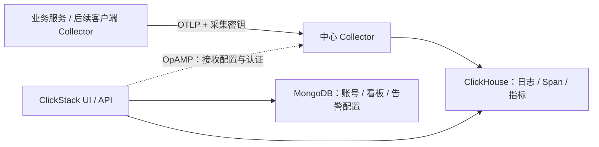

# Observability Infra

本项目维护共享可观测平台的部署配置、采集约定和运维说明。当前采用 ClickStack 开源组件，通过 Docker Compose 部署官方 UI/API、Collector、ClickHouse 和 MongoDB；不编译或修改 ClickStack 源码。

当前为**已启动并通过组件健康检查的本地单机平台**（2026-11-10）。已生成本地 `.env`，四个组件均为 healthy；尚未创建平台账号，也未接入业务服务的日志、Span 和指标。客户端日志采集、容量水位自动清理、备份任务、业务看板及 Profiling 均需后续接入。

## 目录和文件含义

```text
observability-infra/
├── README.md
├── compose.yaml
├── .env.example
├── .gitignore
├── go.mod
├── collector/
│   ├── README.md
│   └── custom.yaml
├── clickhouse/
│   ├── README.md
│   ├── retention.sql
│   └── config.d/
│       └── observability.xml
├── dashboards/
│   └── README.md
└── operations/
    └── README.md
```

| 文件 | 含义 | 如何使用或生效 |
| --- | --- | --- |
| `README.md` | 项目入口，说明文件职责、部署步骤和当前能力边界 | 阅读本文 |
| `compose.yaml` | 定义四个组件的镜像、端口、内存、依赖、挂载和日志轮转 | `docker compose` 读取 |
| `.env.example` | 镜像版本、端口、密钥和保留时长的配置模板 | 复制为 `.env` 后填写；示例本身不会自动加载 |
| `.gitignore` | 排除实际密钥、持久化数据、备份和 IDE 文件 | Git 使用；本项目当前无需自动初始化 Git |
| `go.mod` | 创建项目时已有的 Go 模块声明 | 原样保留；当前 Compose 部署不需要编译 Go 程序 |
| `collector/README.md` | 说明中心 Collector、上传认证、字段映射以及未来客户端采集职责 | 采集接入时参考 |
| `collector/custom.yaml` | 官方 Collector 的配置合并片段，设置内存保护和批处理 | 由 Compose 挂载，通过 `CUSTOM_OTELCOL_CONFIG_FILE` 加载 |
| `clickhouse/README.md` | 说明存储目录、遥测表、TTL 和已有表变更方式 | 存储管理时参考 |
| `clickhouse/config.d/observability.xml` | ClickHouse 自身日志轮转、诊断表保留规则和内部指标端点 | 挂载到数据库 `config.d`，启动时合并 |
| `clickhouse/retention.sql` | 根据已核验的 2.43.1 表结构设置日志/Span 7 天、指标 30 天 TTL | 首次建表后显式执行；本机已执行并核验 |
| `dashboards/README.md` | 约定看板定义和统计口径，避免把 Span 数当作接口调用数 | 后续增加经过验证的看板配置和查询 |
| `operations/README.md` | 说明容量治理、备份、恢复及升级职责 | 运维实施依据；当前不含自动删除或备份程序 |

运行时会产生 `.env` 和 `.data/`，它们不应提交到版本控制。目录内用实际说明文件保留职责，不使用 `.gitkeep`。

## 数据流和组件职责



`Logs`、`Traces`、`Metrics` 的默认数据源已在 Compose 中声明，日志与 Trace 按名称双向关联。数据源配置用于首次账号初始化；修改 Compose 不应被当作已有账号的数据源迁移手段。已有配置需通过 UI/API 检查和更新。

## 本地部署步骤

以下步骤用于复现部署。本机已经完成 `.env` 配置和首次启动；不要用空白示例覆盖现有 `.env`。

### 1. 准备环境和密钥

安装支持 Compose v2 或更新版本的 Docker。示例模板的四个容器内存上限合计为 8 GiB。本机 Docker 可用约 8 GiB，因此实际 `.env` 使用 ClickHouse 3 GiB、UI/API 1 GiB、MongoDB 512 MiB、Collector 1 GiB，合计 5.5 GiB，以预留运行空间。这些资源值尚未经过业务负载验证。

在项目根目录执行：

```bash
test -e .env || cp .env.example .env
```

分别执行两次以下命令，把两个不同的结果填写到 `.env` 的 `CLICKHOUSE_PASSWORD` 和 `EXPRESS_SESSION_SECRET`：

```bash
openssl rand -hex 32
```

ClickHouse 密码使用生成的十六进制字符串，避免破坏 Compose 中的连接 JSON。空密钥会使 Compose 校验失败。本机已生成两个独立随机值，并将 `.env` 权限设为 `0600`。平台登录账号将在 UI 中创建；这两个值均不是业务上传时使用的 Ingestion API Key。

### 2. 校验、拉取和启动

```bash
docker compose config --quiet
docker compose pull
docker compose up -d
docker compose ps
```

`config --quiet` 只做配置检查；不要把包含密钥的完整渲染配置粘贴到公开日志中。上述配置检查不能替代镜像运行和业务接入验收。

平台完成首次建表后，执行分类型保留规则。本机已执行，不需要在每次重启时重复执行；未来变更前先核对实际表结构和保留目标。

```bash
docker compose exec -T clickhouse sh -c 'exec clickhouse-client --user "$CLICKHOUSE_USER" --password "$CLICKHOUSE_PASSWORD" --multiquery' < clickhouse/retention.sql
```

此版本镜像自带的应用健康检查固定访问 8000；Compose 已覆盖为实际端口的 API `/ready`、前端页面和 OpAMP `/ready` 检查，Collector 在应用健康后启动。


### 3. 打开平台并取得上传密钥

浏览器打开 <http://localhost:18080>，创建本地平台账号。当前页面显示账号创建界面，没有预设登录邮箱或密码。创建后进入 Add Data 或 Team Settings 的 API Keys 页面取得 Ingestion API Key。

在首次账号和 Team 创建前，官方 OpAMP 管道不会启用 OTLP 接收器，因此此时 4317/4318 尚不能接收遥测是预期状态；Collector 健康并不等于采集入口已激活。创建账号后再验证带认证的上传链路。

| 入口 | 默认地址 | 说明 |
| --- | --- | --- |
| UI | `http://localhost:18080` | 查看日志、Trace 和看板 |
| UI API | `http://localhost:18001` | 由浏览器 UI 使用 |
| OTLP HTTP | `http://localhost:4318` | 日志、Span、指标的上传基础地址 |
| OTLP gRPC | `localhost:4317` | gRPC 上传入口 |
| OpAMP | Compose 内部 `app:4320` | Collector 配置控制入口，不映射宿主机 |
| ClickHouse / MongoDB | Compose 内部 | 不映射宿主机数据库端口 |

OTLP HTTP 的信号路径分别为 `/v1/logs`、`/v1/traces`、`/v1/metrics`，发送端需要添加 `authorization: <Ingestion API Key>`。实际使用 SDK 时，注意区分它接受“基础地址”还是“完整信号 URL”。

所有发布端口默认只监听 `127.0.0.1`。当前浏览器 URL 也按 localhost 配置，因此这不是直接供多台机器访问的部署配置。远程部署时需要同时调整监听地址、浏览器访问 URL、认证和传输保护。

### 4. 接入业务数据

平台启动后不会自动获得业务服务终端中的日志，也不会自动导出业务进程中已创建的 Span。后续需要：

1. 在业务项目中配置 OpenTelemetry Span 导出，并保持服务名、环境、实例标识与日志一致。
2. 确定日志来源，配置客户端 Collector 读取 JSON 日志、解析字段并上传。
3. 验证同一 TraceId 的日志与 Span 可以关联，再接入 Counter、Histogram 和运行时指标。

本轮没有修改 `go-service-template`，也没有发起业务 HTTP 或 SDK 调用。

## 数据持久化和容量边界

| 本地路径 | 内容 |
| --- | --- |
| `.data/clickhouse/` | 日志、Span、指标表和 ClickHouse 内部数据 |
| `.data/clickhouse-logs/` | ClickHouse 自身文本日志 |
| `.data/mongodb/` | 平台账号、看板和其他配置 |

普通重启及 `docker compose down` 不会移除这些绑定目录。不要把删除 `.data/` 当成常规重启步骤。

当前 2.43.1 legacy/OpAMP 管道通过 `TABLES_RETENTION=720h` 设置统一建表默认值，不读取分信号 TTL 环境变量。`clickhouse/retention.sql` 显式将日志、Span 和 TraceId 查询索引设为 7 天，五类指标表设为 30 天；本机已执行并从实际表定义核验。其他表仍按其实际配置管理，例如未启用的 Session 数据表默认 30 天。TTL 异步执行，不是实时磁盘容量上限。容器内存限制、控制台日志轮转也不能代替数据库容量配额。

当前没有实现总容量达到水位后的自动删除，也没有配置 Collector 持久发送队列。中心不可用或队列耗尽时可能丢失数据。具体后续职责见 [采集说明](collector/README.md) 和 [运维说明](operations/README.md)。

## 停止和查看状态

```bash
docker compose ps
docker compose logs --tail=100 collector
docker compose down
```

## 版本与维护方式

应用和 Collector 固定为上游 `2.43.1`，保留其官方 `hyperdx/*` 镜像名称；ClickHouse 和 MongoDB 使用明确版本。镜像名称保留 HyperDX 不意味着部署的是另一套平台。升级前需要复核兼容性、备份、已有表及数据源变更。

本仓库维护配置，不维护 ClickStack 源码分支。只有现有查询和页面确实不能满足交互需求时，再考虑独立页面或前端定制。当前没有自动生成或导入任何业务看板。

## 本次检查范围

已完成 Compose 静态解析、必填密钥检查、连接和数据源 JSON 解析、挂载路径检查、Collector YAML 与 ClickHouse XML 语法检查；公开镜像标签及 amd64/arm64 支持已核验。

2026-11-10 完成本地启动检查：

| 项目 | 结果 |
| --- | --- |
| ClickHouse / MongoDB / UI/API / Collector | 四个容器均 running、healthy；检查时无异常重启 |
| 前端 | 浏览器显示首次账号创建界面 |
| API `/health`、`/ready` | HTTP 200；MongoDB 连接正常 |
| OpAMP `/ready`、Collector `13133/` | 内部访问 HTTP 200 |
| ClickHouse 内部 `9363/metrics` | HTTP 200，未映射宿主机端口 |
| 保留规则 | 实际表定义为日志/Span 7 天、指标 30 天 |
| 平台账号 | 尚未创建；OTLP 接收待首次创建账号后启用 |

没有接入业务服务，没有发起业务 HTTP/SDK 请求或发送合成遥测验收数据，也没有新增测试用例。本次只验证基础组件、平台页面、内部连接和表配置；不代表业务数据端到端联动已验收。

## YouTube 学习资料

以下均为 ClickHouse 官方视频，主要使用英文，建议按顺序观看；界面和功能可能随版本变化。

1. [Introducing ClickStack — Mark Needham](https://www.youtube.com/watch?v=3waDYancX_c)：架构、Docker 启动、日志查询和 Collector 入门。
2. [Introducing ClickStack: Live Demo and Q&A — Mike Shi](https://www.youtube.com/watch?v=IUu-0dWv0sI)：日志、Trace 和指标的完整产品演示。
3. [ClickStack Demo Days #1](https://www.youtube.com/watch?v=90NWWl6HkPI)：SQL 图表、Trace 时间线及 Span 分析。视频还包含其他产品功能演示，不应将所有片段都视为当前开源部署的能力。


## 官方参考

- [ClickStack 开源架构](https://clickhouse.com/docs/clickstack/architecture)
- [官方 Docker Compose 部署](https://clickhouse.com/docs/clickstack/deployment/docker-compose)
- [上游发布版本](https://github.com/ClickHouse/ClickStack/releases)
- [官方 Compose 配置](https://github.com/ClickHouse/ClickStack/blob/main/docker-compose.yml)
- [官方 Collector 配置](https://github.com/ClickHouse/ClickStack/blob/main/docker/otel-collector/config.yaml)
- [ClickStack TTL 管理](https://clickhouse.com/docs/clickstack/managing/ttl)
- [生产部署说明](https://clickhouse.com/docs/clickstack/managing/production)
