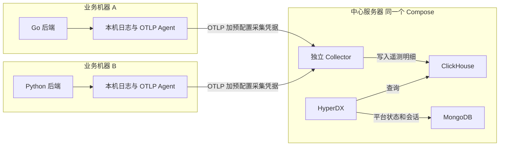
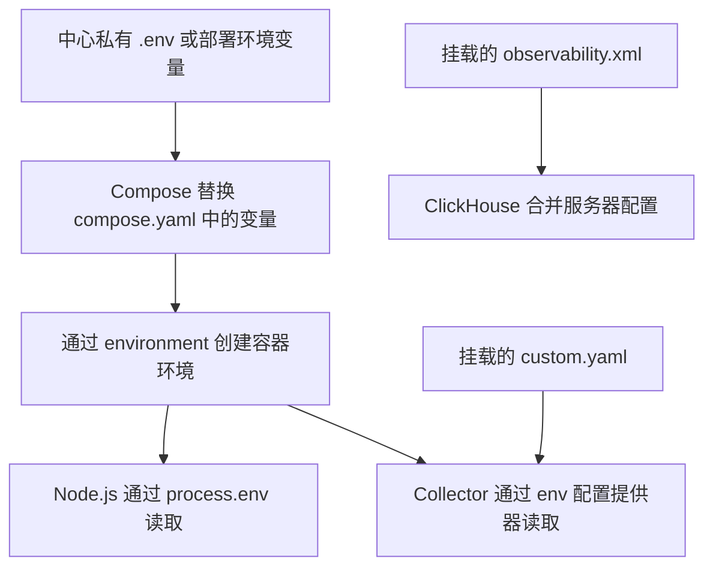
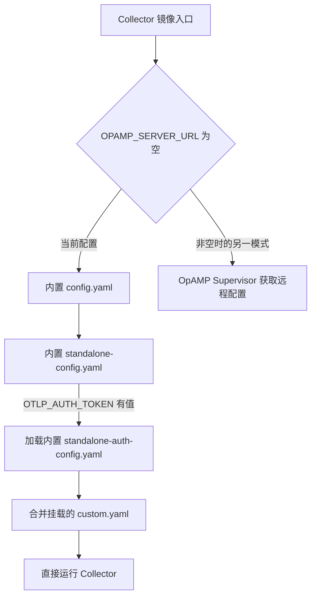
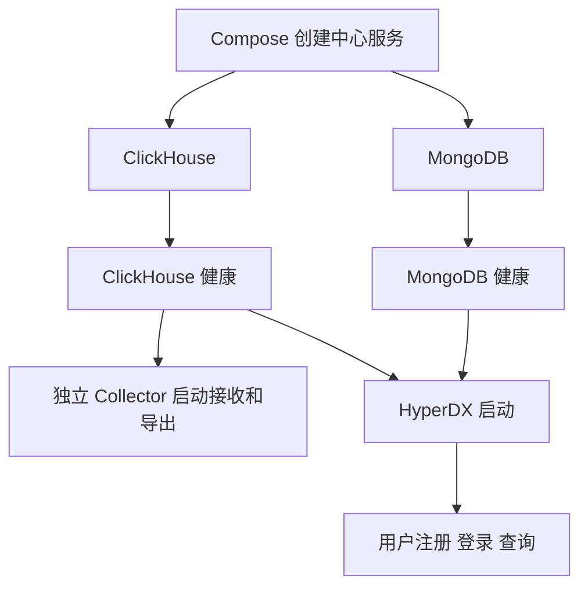
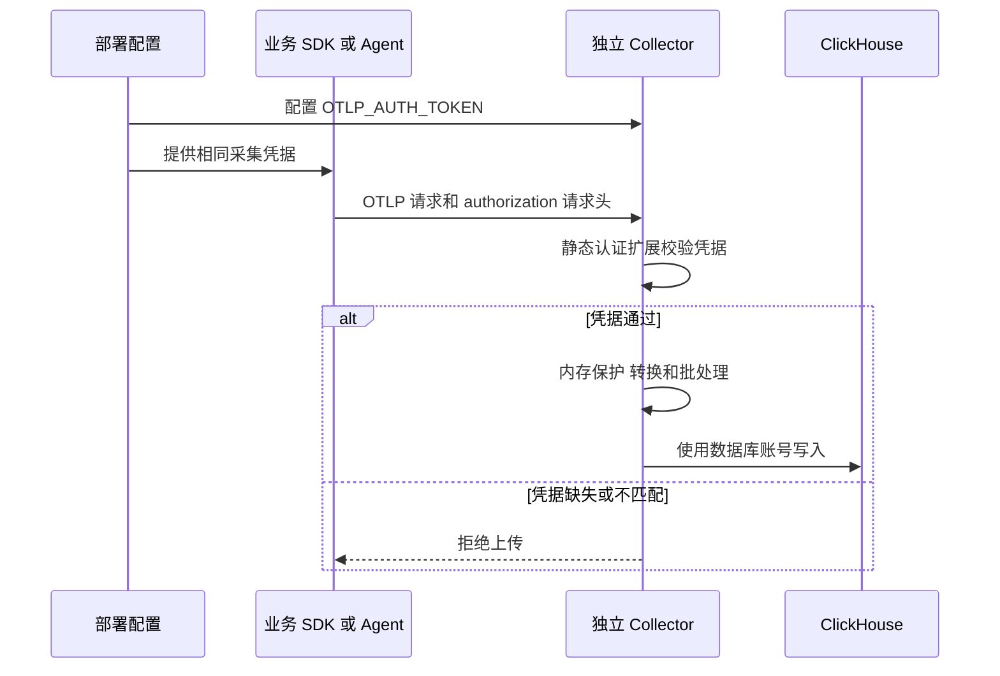
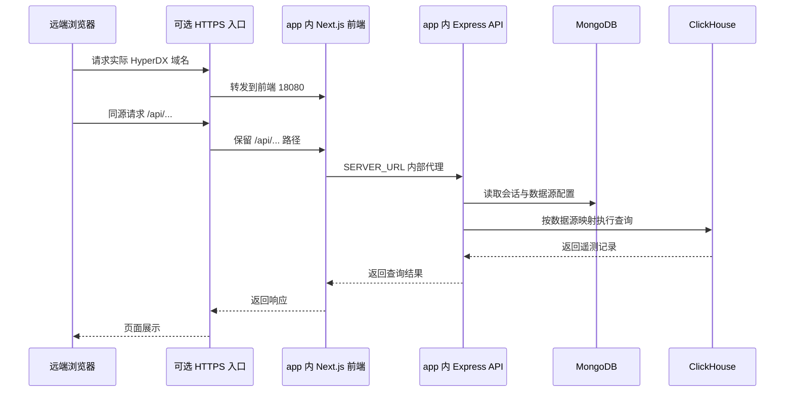
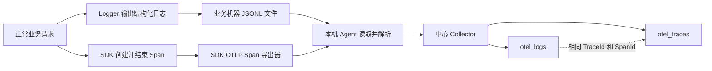
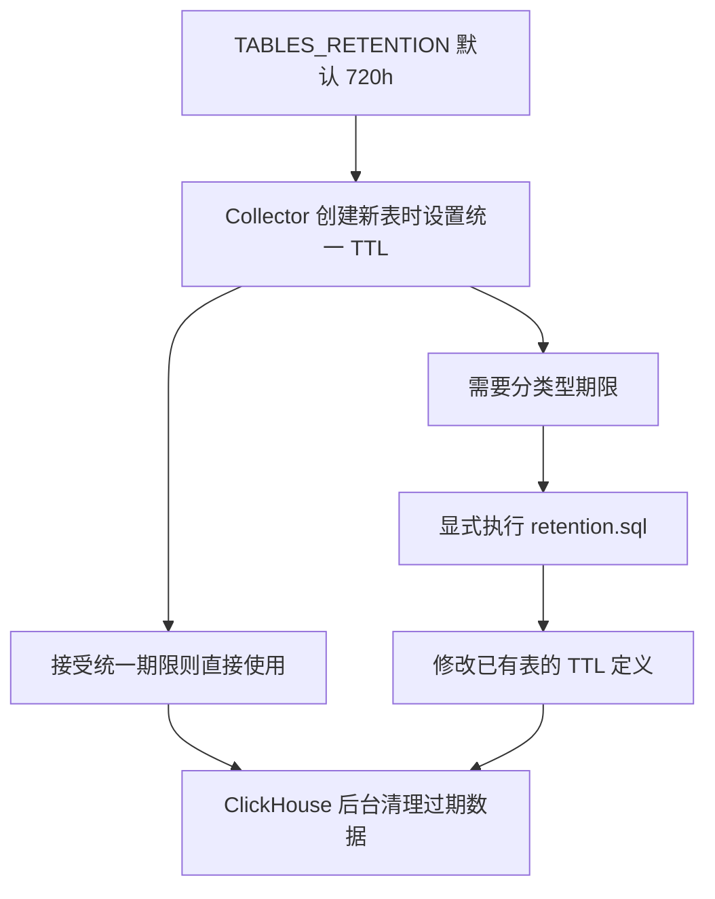

# Compose 配置与日志链路说明

这套配置把一台服务器作为中心可观测平台：独立 Collector 接收多台业务机器上传的日志、Span 和指标，ClickHouse 保存遥测明细，HyperDX 提供查询和展示，MongoDB 保存 HyperDX 的账号、会话和看板等平台状态。

四个中心组件仍放在同一个 [compose.yaml](compose.yaml) 中。Collector 的配置和采集认证由本地文件及预配置密钥管理，不再依赖 HyperDX 注册账号或通过 OpAMP 下发配置。这里的“独立”描述组件之间的控制关系，不要求拆成不同服务器或不同 Compose。

当前中心配置已提供远程采集入口、静态认证、处理管道和数据库导出。业务机器上的日志 Agent、Go/Python 的日志落盘和 Span 导出仍需要在各业务项目中接入；启动中心容器不会自动读取其他机器的终端日志。

## 1 整体部署和数据去向



图中的业务侧 Agent 是接入目标，需要部署在日志文件所在的机器上。一台业务机器上的 Agent 可以负责多个服务。SDK 也可以直接向中心发送 OTLP；使用本机 Agent 时，可以把中心地址、认证、缓冲和重试集中放在 Agent 中管理。

| 服务名 | 职责 | 主要数据 |
| --- | --- | --- |
| `clickhouse` | 接收写入并执行查询 | 业务日志、Span、指标、数据库内部诊断数据 |
| `mongodb` | 保存 HyperDX 平台状态 | 账号、登录会话、数据库连接、数据源、看板、告警等 |
| `app` | 运行 HyperDX 前端、API 和告警任务 | 查询 ClickHouse，读写 MongoDB |
| `collector` | 接收、认证、处理和导出遥测 | 把 OTLP 数据直接写入 ClickHouse |

业务日志和 Span 不经过 MongoDB 中转。HyperDX 不参与当前 Collector 的上传认证；即使尚未注册 HyperDX 用户，Collector 也可以按预配置凭据启动和接收数据。

| 名称 | 描述什么 |
| --- | --- |
| 日志 Log | 某个时刻发生的事件，例如收到请求、校验失败或操作完成 |
| Span | 一次操作的开始、结束、持续时间、状态及父节点，例如一次 HTTP 请求或数据库调用 |
| Trace | 通过相同 TraceId 关联起来的一组 Span，用父子关系还原调用过程 |
| 指标 Metric | 随时间记录的数值、计数或分布，例如请求量、内存使用量、耗时分布 |

## 2 从哪些文件读取配置

| 文件 | 生效方式 |
| --- | --- |
| `compose.yaml` | Docker Compose 读取，决定容器、依赖、端口、环境变量和挂载 |
| `.env.example` | 参数模板，不会代替 `.env` 自动提供实际密钥 |
| `.env` | 当前部署的私有参数来源之一，不应提交到公共仓库 |
| `collector/custom.yaml` | 只读挂载到 Collector，与镜像内置配置合并 |
| `clickhouse/config.d/observability.xml` | 挂载到 ClickHouse 的 `config.d`，与主配置合并 |
| `clickhouse/retention.sql` | 可选的数据库修改语句，需要在表存在后显式执行 |
| `operations/remote-access.md` | 中心地址、跨机器访问和公网 HTTPS 配置说明 |
| `operations/nginx-hyperdx.conf.example` | 可选的宿主机 Nginx 示例，不会自动加载或申请证书 |

需要区分两次变量读取：Compose 先替换 YAML 中的部署参数，Collector 随后读取自己进程里的环境变量。



例如，Compose 中的 `${TABLES_RETENTION:-720h}` 先得到一个时长，再传入容器的 `HYPERDX_OTEL_EXPORTER_TABLES_TTL`。挂载文件中的 `${env:HYPERDX_OTEL_EXPORTER_TABLES_TTL:-720h}` 则由 Collector 自己读取。

`.env` 不会把所有变量自动送进所有容器；需要由对应服务的 `environment` 引用。Go/Python 业务进程也不会自动读取中心服务器上的 `.env`，它们的导出地址和凭据由业务部署配置提供。

## 3 先理解 Compose 的公共写法

### 项目名和服务名

`name: observability-infra` 为这组容器和网络指定默认项目名。`clickhouse`、`mongodb`、`app`、`collector` 是服务名，也是同一 Compose 网络中的可解析主机名。

默认容器名通常类似 `observability-infra-clickhouse-1`，默认网络通常是 `observability-infra_default`。其他业务机器不能依赖这套 Docker 内部 DNS，必须使用中心服务器可达的 IP 或域名。

### 变量替换

| 写法 | 含义 |
| --- | --- |
| `${VAR:-default}` | 变量未设置或为空时采用默认值 |
| `${VAR:?错误说明}` | 变量未设置或为空时停止本次 Compose 操作并报错 |
| `$$VAR` | 让 Compose 保留一个 `$`，交给容器内 shell 再展开变量 |

shell 环境中的同名变量可以覆盖 `.env`。示例中的版本、端口和内存是默认值，当前实例实际使用的值取决于部署提供的参数。

### 重启 内存 依赖和挂载

| 字段 | 作用与边界 |
| --- | --- |
| `image` | 指定现成镜像及版本；本项目没有本地编译步骤 |
| `restart: unless-stopped` | 主进程退出后尝试恢复，人为停止后保持停止；删除容器不会自动重建 |
| `mem_limit` | 整个容器的内存上限，不代表启动即占满，也不限制磁盘 |
| `depends_on` 加 `service_healthy` | 启动时等待依赖健康，不会在运行期间自动重启所有下游 |
| `environment` | 传入容器进程的环境变量 |
| `volumes` | 将宿主机文件或目录绑定到容器路径；`:ro` 表示容器只读 |
| `ports` | 发布宿主机入口，格式为 `监听地址:宿主机端口:容器端口` |
| `healthcheck` | 附加健康状态；单独 `unhealthy` 不会触发 `unless-stopped` 重启 |

相对挂载路径以本项目 Compose 文件所在目录为基准。没有 `ports` 不妨碍同网容器通信，只是没有创建对应的宿主机发布入口。

### 公共容器日志规则

`x-logging: &container-logging` 定义可复用配置块；服务通过 `logging: *container-logging` 才采用它。`&` 是 YAML 锚点，`*` 是引用，不会自动影响机器上的所有容器。

`driver: local` 收集容器标准输出和标准错误。`max-size: "10m"` 让单个文件达到约 10 MB 时轮转，`max-file: "3"` 最多保留三个文件，包含当前文件。默认压缩会影响实际磁盘占用。

这里管理的是 Docker 保存的控制台日志。数据库中的业务日志表、ClickHouse 自己写的文件日志、业务机器的原始 JSONL 文件及可能存在的采集队列分别管理。

## 4 ClickHouse 服务

ClickHouse 是遥测存储。默认镜像为 `clickhouse/clickhouse-server:26.8.36.3-alpine`，其中 `alpine` 表示基础镜像变体；默认容器内存上限为 4 GiB，可由 `CLICKHOUSE_MEMORY_LIMIT` 调整。

### 初始化数据库和账号

| 环境变量 | 当前用途 |
| --- | --- |
| `CLICKHOUSE_DB: otel` | 在初始化流程中创建遥测数据库 |
| `CLICKHOUSE_USER: observability` | 配置数据库账号，不是 Linux 用户 |
| `CLICKHOUSE_PASSWORD` | 数据库连接密码，Compose 要求非空 |
| `CLICKHOUSE_DEFAULT_ACCESS_MANAGEMENT: "1"` | 为配置账号开启通过 SQL 管理用户、角色和权限的能力 |

镜像启动脚本处理这些参数。创建 `otel` 数据库与创建业务表是两件事；遥测表由 Collector 的导出流程创建。已有数据目录、账号配置和 SQL 用户各有自己的初始化机制，不能把修改环境变量当作通用数据库迁移。

当前 HyperDX 和 Collector 共用 `observability` 账号。拆分查询、写入和运维账号属于后续权限管理工作，业务机器无需取得这个数据库密码。

### 存储和内部端口

| 宿主机内容 | 容器位置 | 用途 |
| --- | --- | --- |
| `.data/clickhouse/` | `/var/lib/clickhouse` | 表数据、元数据和内部诊断数据 |
| `.data/clickhouse-logs/` | `/var/log/clickhouse-server` | 数据库自身文本日志 |
| `clickhouse/config.d/observability.xml` | `/etc/clickhouse-server/config.d/observability.xml` | 服务器配置片段，只读 |

删除或替换容器不会自动删除宿主机绑定目录。重新挂载同一路径，可以继续使用已有数据；绑定目录本身没有硬配额。

XML 管理文本日志级别与轮转、部分系统诊断表 TTL，以及 `9363/metrics`。它与镜像主配置合并，不替换整个服务器配置。

| 内部地址 | 谁使用 |
| --- | --- |
| `clickhouse:9000` | Collector 以原生 TCP 协议写入 |
| `http://clickhouse:8123` | HyperDX 以 HTTP 接口查询 |
| `http://clickhouse:9363/metrics` | Collector 抓取数据库自身指标 |

这些数据库端口不向业务机器发布。远端服务把数据交给 Collector，由中心完成数据库连接。

### 健康检查和文件描述符

健康检查在容器内使用配置账号执行 `SELECT 1`。`CMD-SHELL` 支持 shell 展开变量及输出重定向；`$$CLICKHOUSE_USER` 经 Compose 保留为 `$CLICKHOUSE_USER`，再由容器内 shell 读取。

检查成功说明能连接、认证并执行基础查询，不证明遥测表已创建。正常检查间隔 10 秒，单次超时 5 秒，连续失败 12 次标记不健康，启动宽限期 30 秒。

`ulimits.nofile` 的软硬限制都为 `262144`，提高进程可打开的文件描述符额度，包括文件和网络套接字。它不预先打开这么多文件，也不是表数量或整机连接数限制。

## 5 MongoDB 服务

默认镜像为 `mongo:5.0.32-focal`，默认容器内存上限为 1 GiB。`.data/mongodb/` 绑定到 `/data/db`，保存平台状态，并不保存业务遥测明细。

当前 MongoDB 没有启用数据库认证，也没有发布宿主机数据库端口。HyperDX 使用 `mongodb://mongodb:27017/hyperdx` 连接。网页登录账号与 MongoDB 数据库账号是两套身份。

如果为已有数据库开启认证，需要先处理用户创建与应用连接凭据。不能假设向已有数据目录补 `MONGO_INITDB_ROOT_USERNAME/PASSWORD` 就会自动创建管理员；初始化账号流程会跳过已初始化的数据库。

健康检查直接执行 `mongo --quiet --eval ...`。`db.adminCommand('ping').ok` 检查响应标记，`quit` 用成功退出码 0、失败退出码 1 告诉 Docker 结果。`ping` 不要求认证，不能证明账号或实际读写权限正常。

检查间隔 10 秒，超时 5 秒，连续失败 12 次标记不健康，启动宽限期 20 秒。容器的控制台日志继续采用公共 `local` 轮转规则。

## 6 独立 Collector 的配置加载

### 当前镜像与运行模式

当前保留 `hyperdx/hyperdx-otel-collector:2.43.1`，使用它真正的 standalone 独立模式。它包含本项目使用的 OTel 组件、日志转换和 legacy/Map 导出流程；并未换成只靠一份自有完整配置启动的标准 Collector Contrib 镜像。

`OPAMP_SERVER_URL: ""` 明确选择独立模式，入口直接启动 Collector，不启动 OpAMP Supervisor。Collector 只等待 ClickHouse 健康，不等待 HyperDX 或 MongoDB。

配置的组合顺序如下：



| 加载顺序 | 文件来源 | 容器内路径 |
|---:|---|---|
| 1 | 镜像内置，上游 `docker/otel-collector/config.yaml` | `/etc/otelcol-contrib/config.yaml` |
| 2 | 镜像内置，上游 `docker/otel-collector/config.standalone.yaml` | `/etc/otelcol-contrib/standalone-config.yaml` |
| 3 | 镜像内置，上游 `docker/otel-collector/config.standalone.auth.yaml`。当前独立模式下，启动脚本发现 `OTLP_AUTH_TOKEN` 有值时加载 | `/etc/otelcol-contrib/standalone-auth-config.yaml` |
| 4 | 本项目的 `./collector/custom.yaml`，通过 `volumes` 只读挂载 | `/etc/otelcol-contrib/custom.yaml` |

上游 Dockerfile 在构建镜像时就把前三份复制进了镜像文件系统，因此它们随容器提供，在本项目目录和 `volumes` 列表里都找不到。Compose 通过 `CUSTOM_OTELCOL_CONFIG_FILE` 把第四份的容器内路径传给镜像入口脚本。脚本按表中的顺序传入四个 `--config` 参数，由同一个 Collector 进程合并后使用。

Compose 从 `.env` 或启动 Compose 的 shell 环境取出 `OTLP_AUTH_TOKEN`，通过 `collector.environment` 传进容器。镜像启动脚本和 Collector 进程都可以读取这个环境变量。

1. **启动脚本用它判断是否加载认证文件。** 当前独立模式走静态认证分支。脚本中的 `-n` 检查变量是否非空，条件成立就把第三份 YAML 的路径加到启动参数里。当前 Compose 要求这个变量有值，因此正常启动时会加载第三份文件。 [镜像入口脚本](https://github.com/hyperdxio/hyperdx/blob/821c2f93357b47d5ff932ea99d2adf93289815a5/docker/otel-collector/entrypoint.sh#L93-L113)

   ```sh
   # /entrypoint.sh 中的静态认证分支摘录
   elif [ -n "$OTLP_AUTH_TOKEN" ]; then
     COLLECTOR_ARGS="$COLLECTOR_ARGS --config /etc/otelcol-contrib/standalone-auth-config.yaml"
   ```

2. **Collector 用它的具体值验证请求。** 内置 YAML 通过 `${env:OTLP_AUTH_TOKEN}` 引用环境变量。Collector 读取配置时把这个占位符展开为容器环境中的 token，并把得到的值交给 `bearertokenauth/hyperdx` 认证器。该文件同时把这个认证器挂到 OTLP 的 HTTP 和 gRPC 接收器上。下面是 `tokens` 字段中的两条规则。 [内置认证配置](https://github.com/hyperdxio/hyperdx/blob/821c2f93357b47d5ff932ea99d2adf93289815a5/docker/otel-collector/config.standalone.auth.yaml)

   ```yaml
   tokens:
     - ${env:OTLP_AUTH_TOKEN}
     - Bearer ${env:OTLP_AUTH_TOKEN}
   ```

   业务后端通过 HTTP 上报时，可以发送 `Authorization: Bearer <你的 token>`。认证器会把请求头的值和展开后的规则比较。gRPC 使用同名的 `authorization` 元数据传递凭据。

Collector 启动后，可以在项目目录下列出容器内的配置文件。

```bash
docker compose exec collector ls -l /etc/otelcol-contrib/
```

本项目不走图中的 OpAMP 分支。HyperDX 镜像仍启动自己的内部 OpAMP 服务，但采集不使用它，app 的健康检查也不再依赖该端口。

合并时，同名映射项可以补充或覆盖局部字段，列表则需要特别注意替换行为。`custom.yaml` 没有重新定义 `service.extensions`，以保留镜像已经加载的 `health_check` 和静态认证扩展。它不能单独作为普通 Contrib Collector 的完整配置使用。

### 启动关系



Collector 没有从“用户注册”返回的启动依赖。HyperDX 自身遥测的导出地址指向 Collector，但这没有增加 Compose 的反向启动依赖。

### 接收端口和认证过程

宿主机发布地址由 `OTLP_BIND_ADDRESS` 控制，默认 `0.0.0.0`，使其他机器可以连接中心。`OTLP_GRPC_PORT` 默认 4317，`OTLP_HTTP_PORT` 默认 4318，容器内监听端口固定为 4317 和 4318。

两端口区分传输协议，都可承载日志、Span 和指标。HTTP 使用 `/v1/logs`、`/v1/traces`、`/v1/metrics` 路径；SDK 接受基础地址还是完整信号路径，取决于对应 SDK 的配置接口。



静态认证同时用于 HTTP 和 gRPC，当前镜像接受裸 token 和 `Bearer <token>` 等兼容形式。`OTLP_AUTH_TOKEN` 由部署前配置，不从 HyperDX 团队信息获取。正常重启继续使用同一值；轮换时需要同时更新接收端和发送端。

### ClickHouse 写入与建表

| Collector 环境变量 | 作用 |
| --- | --- |
| `CLICKHOUSE_ENDPOINT` | `tcp://clickhouse:9000?dial_timeout=10s`，原生协议写入地址；10 秒是建连超时 |
| `CLICKHOUSE_USER` | 写入数据库账号，当前为 `observability` |
| `CLICKHOUSE_PASSWORD` | 数据库认证凭据，业务发送端不需要取得它 |
| `HYPERDX_OTEL_EXPORTER_CLICKHOUSE_DATABASE` | 目标数据库，当前为 `otel` |
| `HYPERDX_OTEL_EXPORTER_CREATE_LEGACY_SCHEMA` | 当前为 `"true"`，使用导出器负责的 legacy 建表方式 |
| `HYPERDX_OTEL_EXPORTER_TABLES_TTL` | 新建表的统一默认保留时长，由 `TABLES_RETENTION` 提供 |
| `HYPERDX_LOG_LEVEL` | Collector 自身日志级别，不过滤所有业务日志到该级别 |
| `CUSTOM_OTELCOL_CONFIG_FILE` | 挂载配置片段的容器路径 |

`CREATE_LEGACY_SCHEMA=true` 会跳过另一套独立迁移工具，并由导出器按 `create_schema=true` 创建所需表。这仍是建表流程；对已有表的结构、权限和 TTL 修改需要相应数据库操作。

### 按顺序读 collector/custom.yaml

#### 1. `receivers.prometheus/clickhouse` 配置从哪抓指标

`receivers` 定义输入组件。`prometheus/clickhouse` 是一个 Prometheus 接收器实例，`config.scrape_configs` 列出它要执行的抓取任务。

- `job_name: clickhouse` 给抓取任务命名，方便区分指标来源。
- `scrape_interval: 30s` 表示每 30 秒抓取一次。
- `metrics_path: /metrics` 是抓取时访问的 HTTP 路径。
- `static_configs` 下的 `targets` 列出固定的抓取地址。Compose 通过 `CLICKHOUSE_METRICS_TARGET` 传入 `clickhouse:9363`，YAML 里也用这个地址作为默认值。

这几个字段合起来，就是 Collector 每 30 秒访问一次 `http://clickhouse:9363/metrics`，读取 ClickHouse 自身的运行指标。

#### 2. `processors.memory_limiter` 配置什么时候暂停接收

这个处理器检查 Collector 存放运行中对象的内存，也就是 Go 堆。内存占用过高时，它会暂时拒收更多数据，告诉发送方可以稍后重试。

- `check_interval: 1s` 表示每秒检查一次内存。
- `limit_mib: 768` 设置堆内存硬阈值。检查发现超过 768 MiB 时，限制器会进一步尝试强制垃圾回收。
- `spike_limit_mib: 128` 为两次检查之间的内存增长留出余量。开始限制的软阈值是 `768 - 128 = 640 MiB`，检查发现堆内存超过这个值就会暂时拒收。

整个容器的内存上限由 Compose 的 `mem_limit` 控制，`COLLECTOR_MEMORY_LIMIT` 默认是 1 GiB。上面的 640 MiB 和 768 MiB 用于 Collector 内部判断，修改容器上限时应一起查看这两个阈值。

#### 3. `processors.batch` 配置什么时候发一批、每批多大

- `timeout: 5s` 设置定时发送间隔。即使只有几十条，定时触发时也会把已经积攒的数据交给下游。
- `send_batch_size: 1000` 设置按数量触发的阈值。攒到 1000 条就可以发送。例如一次收到 1500 条，可以一起交给下游。
- `send_batch_max_size: 2000` 设置单批数量上限。攒到超过 2000 条时，发送前会拆成较小的批次。

日志按日志记录数算，Trace 按 Span 数算，指标按数据点数算。这里的发送是交给后续导出器，实际写入还要经过导出器的处理。

#### 4. `exporters` 下的 `ttl` 配置新表默认保留多久

- `clickhouse.ttl` 为普通导出器创建的日志、Span 和指标表设置默认保留期。
- `clickhouse/rrweb.ttl` 为浏览器会话回放表设置相同的默认保留期。会话回放用于重现用户在网页上的点击、滚动和页面变化，需要业务网页接入录制 SDK。本项目目前保留了写入分支，尚未接入录制。

两处都写 `${env:HYPERDX_OTEL_EXPORTER_TABLES_TTL:-720h}`。Compose 把 `TABLES_RETENTION` 的值传给这个容器环境变量，默认 `720h`，也就是 30 天。已有表继续使用各自表定义中的 TTL。

#### 5. `service.pipelines.metrics/clickhouse` 把抓取、处理和写库连起来

`metrics/clickhouse` 是实际运行的指标管道。它按下列字段引用前面定义的组件。

- `receivers: [prometheus/clickhouse]` 使用第 1 项的接收器抓取指标。
- `processors: [memory_limiter, batch]` 先做第 2 项的内存保护，再按第 3 项积攒批次。
- `exporters: [clickhouse]` 把处理完的指标交给 ClickHouse 导出器，写入 `otel.otel_metrics_*` 中对应的表。

## 7 HyperDX 如何查询和展示

### 进程 地址和会话

默认镜像为 `hyperdx/hyperdx:2.43.1`。同一 app 容器运行 Next.js 前端、Express API 和告警检查任务，默认共享 2 GiB 内存。

| 配置 | 当前含义 |
| --- | --- |
| `HYPERDX_APP_PORT` | 前端容器端口，默认 18080 |
| `HYPERDX_API_PORT` | API 容器端口，默认 18001 |
| `HYPERDX_APP_LISTEN_HOSTNAME` | 前端在容器内部监听 `0.0.0.0` |
| `HYPERDX_BIND_ADDRESS` | 前端的宿主机发布地址，默认 `0.0.0.0` |
| `FRONTEND_URL` | 从 `HYPERDX_PUBLIC_URL` 取得浏览器实际入口，用于 Cookie、跨域、跳转和链接 |
| `SERVER_URL` | Next.js 服务端代理的 API 目标，保持容器内部 `127.0.0.1:18001` |
| `MONGO_URI` | 连接 `mongodb:27017/hyperdx`，保存平台状态和会话 |
| `EXPRESS_SESSION_SECRET` | 登录会话签名密钥，普通重启应保持稳定 |
| `OPAMP_PORT` | 镜像内部服务使用 4320，本采集链路不依赖它 |
| `HYPERDX_LOG_LEVEL` | 平台自身日志详细程度 |
| `USAGE_STATS_ENABLED` | 当前为 `"false"`，关闭产品使用情况统计 |

`EXPRESS_SESSION_SECRET` 用来签名和验证浏览器 Cookie 中的会话标识，实际会话内容保存在 MongoDB。更换它可能要求用户重新登录，不会删除账号、看板或遥测数据。

app 自身 OTel 遥测使用 `OTEL_SERVICE_NAME=clickstack-platform`，导出目标为 `http://collector:4318`，请求头从预配置 `OTLP_AUTH_TOKEN` 生成。它不会给接入的业务服务统一改名，也不代表关闭产品使用统计后停止了业务采集。

### 浏览器只需前端入口



直接 HTTP 访问时，浏览器直接连接前端，跳过图中的可选 HTTPS 入口。API 的宿主机端口只绑定 `127.0.0.1`，普通浏览器通过同源 `/api` 使用它；不需要将 API 端口开放给其他电脑。

`SERVER_URL` 中的回环地址指 app 容器自身，前端和 API 位于同一容器所以成立。它与浏览器使用的 `HYPERDX_PUBLIC_URL` 是两种地址，不要一起替换成公网 IP。

### 数据库连接与数据源映射

`DEFAULT_CONNECTIONS` 的 JSON 配置告诉 HyperDX 如何连接 `http://clickhouse:8123`。`name` 供数据源引用，`username/password` 是数据库凭据。

`DEFAULT_SOURCES` 的 JSON 则告诉平台如何解释表：

| 数据源 | 表或表集合 | 关键字段 |
| --- | --- | --- |
| Logs | `otel.otel_logs` | 时间 `Timestamp`，正文 `Body`，服务 `ServiceName`，级别和 TraceId/SpanId |
| Traces | `otel.otel_traces` | `TraceId`、`SpanId`、`ParentSpanId`、`SpanName`、`Duration`、状态、Events/Links |
| Metrics | `otel.otel_metrics_*` | 按 Gauge、Sum、Histogram、Summary、Exponential histogram 选择对应表 |

通用字段含义如下：

| 映射字段 | 作用 |
| --- | --- |
| `timestampValueExpression` | 时间筛选等查询使用的时间列或表达式 |
| `displayedTimestampValueExpression` | 页面展示的时间，可使用更高精度列 |
| `implicitColumnExpression` | 未指定字段时的默认全文搜索列，日志为 Body，Trace 为 SpanName |
| `eventAttributesExpression` | LogAttributes 或 SpanAttributes 等事件属性 |
| `resourceAttributesExpression` | 服务、主机、实例等资源属性 |
| `defaultTableSelectExpression` | 默认搜索列表显示的列或表达式 |
| `traceSourceId`、`logSourceId`、`metricSourceId` | 关联其他数据源，支持界面跳转 |

Trace 的 `durationPrecision=9` 表示纳秒，列表中的 `round(Duration/1e6)` 转成整数毫秒。Metrics 的 `from.tableName` 留空，是因为实际表由 `metricTables` 按类型选择。

这些 JSON 是初始化模板，不创建遥测表，也不复制数据。新团队在对应配置为空时使用它们；已有配置通过 **Team Settings → Data → Connections/Sources** 更新，保存到 MongoDB。修改模板并重启不会自动覆盖已保存的连接和字段映射。

## 8 日志和 Span 是两条有关联的数据通道



图中 Span 经本机 Agent 转发是一种接入方式，也可以由 SDK 直接发中心。真正的调用树来自 Span 的父子关系；只在日志正文中打印一个 TraceId 不会自动生成调用树。

Go 项目现有公共 Logger 已具备 stdout 单行 JSON，Tracing 已有部分 Span 边界。中心配置没有把 stdout 自动保存成文件，也没有为业务 SDK 装配导出器；这些需要在 Go/Python 项目和业务机器部署中继续实现。

日志 Agent 应按下面的约定解析业务 JSON：

| 业务字段 | 标准目标 |
| --- | --- |
| `timestamp` | 日志 Timestamp |
| `level` | SeverityText 和 SeverityNumber |
| `message` | Body |
| `trace_id`、`span_id` | 标准 TraceId、SpanId |
| `service_name` | Resource 的 `service.name` |
| `environment` | Resource 的 `deployment.environment.name` |
| `instance_id` | Resource 的 `service.instance.id` |
| `component`、`operation`、`event` 等 | LogAttributes |

多台机器应使用不同实例标识，逻辑服务保持稳定服务名。来源属性让数据可区分，但不会自动提供不同团队或租户之间的权限隔离。

## 9 TTL 和 retention.sql 如何配合

`TABLES_RETENTION` 默认 `720h`，即 30 天。当前镜像的 standalone 导出器原本写死这个默认值，因此 `custom.yaml` 显式覆盖两个导出器的 `ttl`，使部署提供的统一时长真正用于建表。



可选的 `retention.sql` 把日志、Span 和 TraceId 时间索引改为 7 天，五类指标为 30 天。它没有被 Compose 挂载或调用，需要在对应表创建后由数据库客户端执行。

以日志表为例：

```sql
ALTER TABLE otel.otel_logs
MODIFY TTL toDateTime(Timestamp) + INTERVAL 7 DAY DELETE;
```

这会将“每条日志的 Timestamp 加 7 天”保存为过期规则。规则保存在 ClickHouse 表定义并随数据目录持久化；以后由数据库后台处理，不需要每天或每次重启重复执行 SQL 文件。

| 修改动作 | 对已有表的影响 |
| --- | --- |
| 改 `.env` 中的默认保留时长 | 不会自动迁移已有表 TTL |
| 编辑 `retention.sql` 文件 | 未执行时不会改变数据库 |
| 执行相应 `ALTER TABLE ... MODIFY TTL` | 更新实际表定义 |
| 已执行过 7 天规则，后来不再运行文件 | 仍保留已有规则，不会自动恢复 30 天 |

TTL 到期代表记录可以清理，实际删除与后台合并有关，不保证到期瞬间释放空间。已有表采用什么期限，以其实际表定义为准。接受统一默认期限的新环境可以不执行该 SQL。

## 10 网络入口与公网访问

| 地址范围 | 用法 |
| --- | --- |
| 同一中心 Compose 网络 | 使用 `collector`、`clickhouse`、`mongodb` 等服务名 |
| 中心宿主机本身 | 使用回环地址和相应发布端口 |
| 其他业务机器 | 使用中心可达的 IP、域名或 OTLP TLS 入口 |
| 其他电脑的浏览器 | 使用 `HYPERDX_PUBLIC_URL` 指定的真实入口 |

`0.0.0.0` 表示监听所有网卡，不能作为浏览器 URL 或 SDK 发送目标。业务机器中的 `localhost` 指该机器或容器自身，也不能指代中心服务器。

### 原生 HTTP 与 HTTPS 的选择

HyperDX 原生支持把 HTTP 前端发布给其他电脑访问，无需先安装 Nginx。当前 Demo 保留 `HYPERDX_PUBLIC_URL=http://localhost:18080`；真实远程部署时，必须改成浏览器实际使用的完整 origin，例如实际服务器 IP 加端口或实际 HTTPS 域名。

当前没有预填真实公网 IP、域名或证书。`HYPERDX_PUBLIC_URL=https://某域名` 只是在声明外部地址，不会让 Node.js 自动开启 TLS，也不会申请证书。

公网 HTTPS 可以由宿主机 Nginx、Caddy 或云负载均衡器提供。浏览器站点和 OTLP HTTP 可使用两个域名，分别转发到前端 18080 和 Collector 4318。使用同一宿主机上的 HTTPS 代理时，可以将 `HYPERDX_BIND_ADDRESS` 和 `OTLP_BIND_ADDRESS` 收紧为 `127.0.0.1`，让外部只访问 TLS 入口。

OTLP HTTP 可以同时承载日志和 Span，因此不必为了两类数据分别公开 HTTP 与 gRPC。若选择 gRPC，应提供相应的 HTTP/2 和 TLS 转发配置，不能直接套用普通 HTTP 代理路径。

详细配置和可选代理文件见 [远程访问说明](operations/remote-access.md) 与 [Nginx 示例](operations/nginx-hyperdx.conf.example)。示例不会自动加载或申请证书。

## 11 健康状态 持久化与运行边界

| 服务 | 健康条件 | 默认参数 |
| --- | --- | --- |
| ClickHouse | 容器内认证后执行 `SELECT 1` | 间隔 10s，超时 5s，失败 12 次，宽限 30s |
| MongoDB | 容器内执行 `ping` | 间隔 10s，超时 5s，失败 12 次，宽限 20s |
| HyperDX | API `/ready` 和前端 `/` 均返回成功状态 | 间隔 10s，整体超时 5s，失败 6 次，宽限 20s |
| Collector | 继承镜像对内部 `13133/` 的检查 | 间隔 30s，超时 5s，失败 3 次，宽限 15s |

启动宽限期内仍会执行检查，成功可提前进入健康状态。健康状态不证明远端网络、业务 SDK 导出、日志字段转换和页面关联都已完成。正常运行中，暂时连接失败由相应客户端和导出器恢复，`depends_on` 不承担运行时故障编排。

| 宿主机目录 | 保留的内容 |
| --- | --- |
| `.data/clickhouse/` | 遥测表、表定义、数据库内部数据 |
| `.data/clickhouse-logs/` | 数据库文本日志 |
| `.data/mongodb/` | 平台账号、会话、看板、连接和数据源 |

当前没有配置持久发送队列、总磁盘硬配额、自动容量水位清理或备份任务。内置的内存缓冲和重试可处理部分暂时失败，但不能等同于磁盘持久队列。业务侧日志文件读取位置、队列、轮转和数据保留应纳入各自部署设计。

## 12 日常修改时应改哪里

| 需求 | 修改位置 | 应用方式 |
| --- | --- | --- |
| 改镜像、发布端口、外部 URL、容器内存或密钥 | 部署 `.env` 或 Compose | 使用 Compose 更新容器配置 |
| 改批次、内存保护、数据库指标抓取等 | `collector/custom.yaml` | 让 Collector 重新加载挂载配置，可正常重启 Collector |
| 改 ClickHouse 自身日志和诊断配置 | `observability.xml` | 按对应服务器设置的加载方式应用 |
| 改已有表 TTL | 数据库 SQL | 显式修改实际表定义 |
| 改已有查询连接或字段映射 | HyperDX 的 Team Settings 中 Data 页面 | 保存到 MongoDB，通常无需重启 |
| 改新团队的默认查询配置 | `DEFAULT_CONNECTIONS` / `DEFAULT_SOURCES` | 更新初始化模板，不覆盖已有配置 |
| 改业务日志格式、文件目录、Span 边界或 SDK 导出 | Go/Python 与各业务机器 Agent | 按业务进程自身的部署方式应用 |

中心的一般启动入口是项目目录下的 `docker compose up -d`。它会根据配置变化更新容器；单纯 `docker compose restart` 会保留旧容器环境，不能用于注入新的 Compose 环境变量。正常停止或替换容器不会自动删除数据库绑定目录。

中心配置就绪后，业务侧仍需要完成日志文件与 Agent、Span 导出器、导出凭据和生命周期收尾的接入。正常请求产生日志和结束 Span 后，才有对应遥测供中心接收与展示。

## 13 配置参数总览

以下为 `.env.example` 提供的默认值或填写要求，不包含当前部署的实际密钥。

| 参数 | 默认值或要求 |
| --- | --- |
| `CLICKHOUSE_IMAGE` | `clickhouse/clickhouse-server:26.8.36.3-alpine` |
| `MONGODB_IMAGE` | `mongo:5.0.32-focal` |
| `CLICKSTACK_APP_IMAGE` | `hyperdx/hyperdx:2.43.1` |
| `CLICKSTACK_COLLECTOR_IMAGE` | `hyperdx/hyperdx-otel-collector:2.43.1`，以 standalone 运行 |
| `HYPERDX_BIND_ADDRESS` | `0.0.0.0` |
| `HYPERDX_PUBLIC_URL` | Demo 为 `http://localhost:18080`，真实地址待部署时填写 |
| `HYPERDX_APP_PORT` | `18080` |
| `HYPERDX_API_PORT` | `18001`，宿主机仅回环发布 |
| `OTLP_BIND_ADDRESS` | `0.0.0.0` |
| `OTLP_GRPC_PORT` | `4317` |
| `OTLP_HTTP_PORT` | `4318` |
| `CLICKHOUSE_PASSWORD` | 必填、稳定保存的数据库密码；本项目要求十六进制以便插入 JSON |
| `EXPRESS_SESSION_SECRET` | 必填、稳定保存的随机会话签名密钥 |
| `OTLP_AUTH_TOKEN` | 必填、预配置的随机采集密钥；本项目使用十六进制以便传递 headers |
| `TABLES_RETENTION` | `720h`，控制新建表的统一默认期限 |
| `CLICKHOUSE_MEMORY_LIMIT` | `4g` |
| `CLICKSTACK_APP_MEMORY_LIMIT` | `2g` |
| `MONGODB_MEMORY_LIMIT` | `1g` |
| `COLLECTOR_MEMORY_LIMIT` | `1g`，需与内部固定内存阈值协调 |

三种密钥分别保护数据库连接、网页登录会话和遥测上传，应分别生成和管理。HyperDX UI 中显示的团队 Ingestion API key 不用于当前独立 Collector 的接收认证。

## 14 继续阅读

- [部署入口与当前范围](README.md)
- [Collector 独立配置与客户端字段约定](collector/README.md)
- [ClickHouse 存储和保留规则](clickhouse/README.md)
- [多机器采集与远程访问](operations/remote-access.md)
- [容量 备份和升级职责](operations/README.md)
- [官方 HyperDX 配置项](https://clickhouse.com/docs/clickstack/managing/config)
- [对应版本 Collector 入口](https://github.com/hyperdxio/hyperdx/blob/821c2f93357b47d5ff932ea99d2adf93289815a5/docker/otel-collector/entrypoint.sh)
- [对应版本 standalone 静态认证](https://github.com/hyperdxio/hyperdx/blob/821c2f93357b47d5ff932ea99d2adf93289815a5/docker/otel-collector/config.standalone.auth.yaml)
- [OpenTelemetry 网关部署模式](https://opentelemetry.io/docs/collector/deploy/gateway/)
